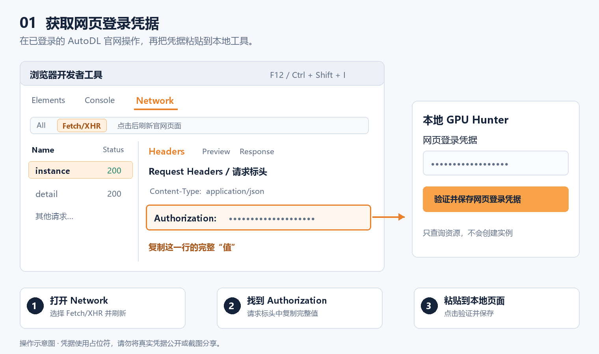
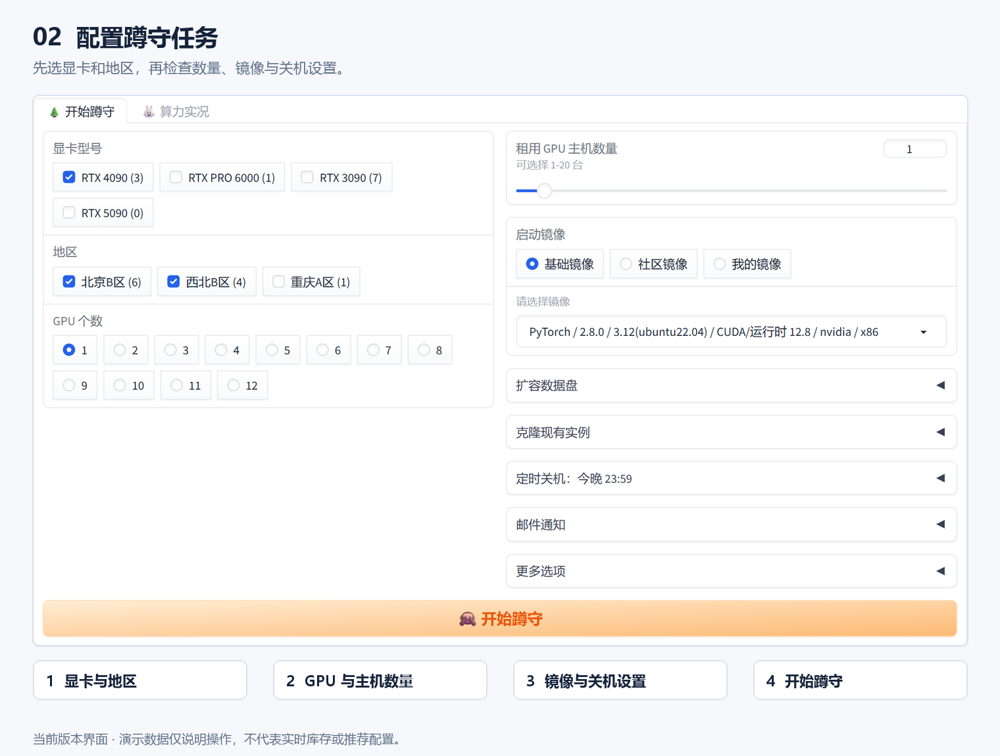
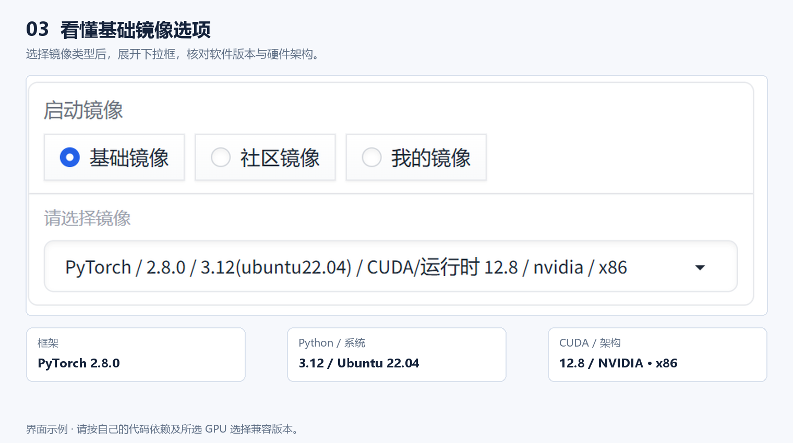
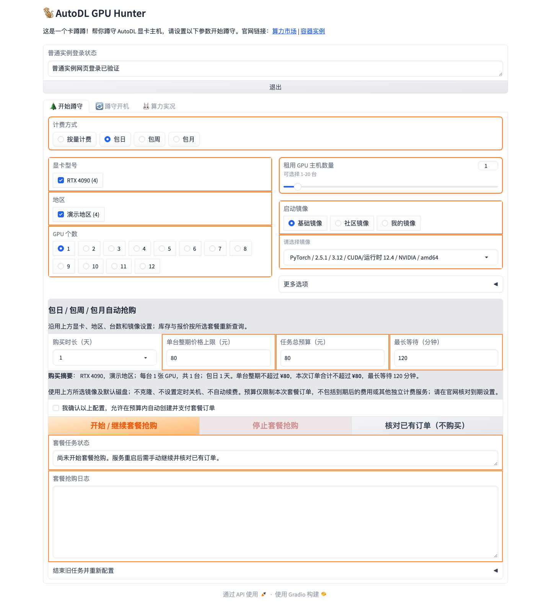
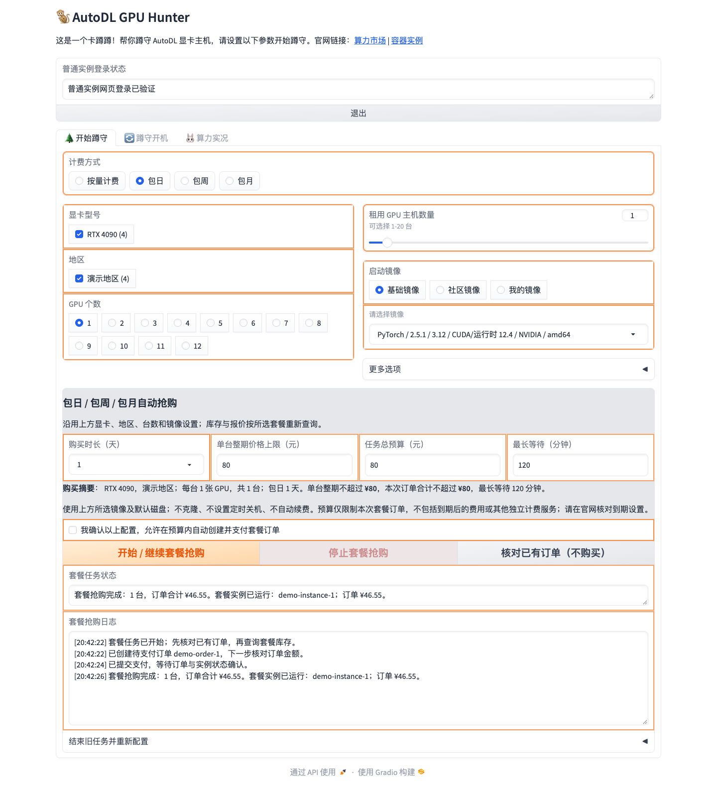
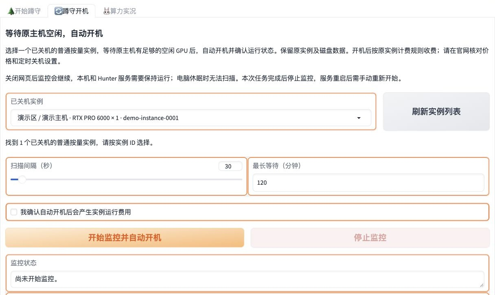
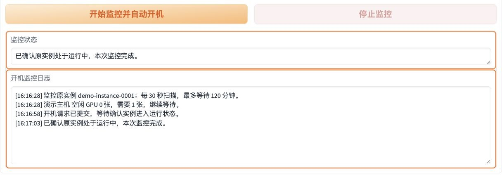

# AutoDL GPU Hunter

在本机运行的 AutoDL 普通容器实例 GPU 蹲守工具。可以按显卡、地区和镜像蹲守新实例，也可以选择已关机的原实例，等待原主机有空闲 GPU 后自动开机。

> **费用提醒：**验证网页登录凭据只查询 AutoDL 资源。点击“开始蹲守”可能创建付费实例；点击“开始监控并自动开机”会在资源满足时启动原实例，产生运行费用。停止本地程序不会关闭云端实例，请在 AutoDL 控制台单独管理。本项目适配普通容器实例，不支持 Pro 实例流程，也不是 AutoDL 官方产品。

[快速开始](#快速开始) · [登录配置](#登录配置) · [开始蹲守](#开始蹲守) · [包日包周包月抢购](#包日包周包月抢购) · [蹲守原实例开机](#蹲守原实例开机) · [常见问题](#常见问题) · [提交问题](https://github.com/cchao-jlu/autodl-gpu/issues)

## 功能

- 按 GPU 型号、地区、每台 GPU 数量和主机数量筛选库存。
- 支持新实例包日、包周、包月抢购：设置整期价格上限和总预算，自动创建订单、核对价格、支付并确认运行；保存任务进度，避免结果不确定时重复购买。
- 监控已关机的普通按量实例，在原主机空闲 GPU 满足原配置时自动开机，保留原实例与磁盘数据。
- 支持基础镜像、社区镜像和个人镜像。
- 支持数据盘扩容、克隆实例、定时关机和邮件通知。
- 服务默认只监听 `127.0.0.1`，不会创建 Gradio 公共分享链接。
- 库存读取遇到部分临时错误时有限重试；创建请求不会自动重试，避免不确定时重复创建。

## 快速开始

需要 Git 和 **Python 3.11**。本地运行不需要 GPU 或 CUDA。macOS 已使用 Python 3.11 验证安装、启动和登录校验；Windows 提供启动脚本；Linux 尚未实机验证。

### macOS / Linux

在终端执行：

```bash
git clone https://github.com/cchao-jlu/autodl-gpu.git
cd autodl-gpu
python3.11 -m venv .venv
.venv/bin/python -m pip install -r requirements-local.txt
PYTHONUTF8=1 GRADIO_ANALYTICS_ENABLED=False .venv/bin/python app.py
```

启动后打开 <http://127.0.0.1:7860>。在终端按 `Ctrl+C` 停止服务。也可以使用 `uv` 创建环境并安装依赖：

```bash
uv venv --python 3.11 .venv
uv pip install --python .venv/bin/python -r requirements-local.txt
```

然后运行最后一条 `app.py` 启动命令。

### Windows / PowerShell

已安装 Python 3.11 时：

```powershell
git clone https://github.com/cchao-jlu/autodl-gpu.git
cd autodl-gpu
py -3.11 -m venv .venv
.\.venv\Scripts\python.exe -m pip install --upgrade pip
.\.venv\Scripts\python.exe -m pip install -r requirements-local.lock.txt
.\start-local.cmd
```

启动后打开 <http://127.0.0.1:7860>。之后可双击 `start-local.cmd` 启动、`stop-local.cmd` 停止后台服务。关闭浏览器不会停止服务。需要在终端查看输出时，可运行：

```powershell
$env:PYTHONUTF8 = '1'
$env:GRADIO_ANALYTICS_ENABLED = 'False'
.\.venv\Scripts\python.exe app.py
```

终端启动的进程用 `Ctrl+C` 停止。不要同时启动多个蹲守进程。

`requirements-local.txt` 为 macOS/Linux 等环境提供兼容依赖约束；`requirements-local.lock.txt` 是 Windows 与 Python 3.11 的已验证版本快照。不要只安装原始 `requirements.txt`，以免 Gradio 与间接依赖版本不兼容。

## 登录配置

普通容器实例需要 AutoDL 官网的**网页登录凭据**。开发者 Token 不能替代它。

1. 在浏览器登录 [AutoDL 容器实例控制台](https://www.autodl.com/console/instance/list)。
2. 打开开发者工具：Mac 上的 Chrome/Edge 按 `⌘ Command + ⌥ Option + I`；Windows 按 `F12` 或 `Ctrl+Shift+I`。
3. 选择 **Network / 网络 → Fetch/XHR**，刷新控制台页面。Mac 按 `⌘ Command + R`，Windows 按 `Ctrl+R`。如果筛选框里已有文字（例如 `auth`），先清除筛选。
4. 找到 `https://www.autodl.com/api/v1/instance` 请求，打开 **Headers / 标头 → Request Headers / 请求标头**，复制 `Authorization` 对应的值。确认选中的是 `instance` 请求，而不是名称里含 `cloudauth` 的请求。
5. 将该值粘贴到本地页面的“网页登录凭据”，点击“验证并保存网页登录凭据”。



*凭据获取操作示意；图中使用占位符。*

如果请求标头里找不到 `Authorization`，可在开发者工具的 **Application / 应用 → Storage / 存储 → Local Storage / 本地存储** 中选择 AutoDL 当前页面的站点，复制 `token` 的 **Value**。只复制值，不要带字段名、引号或整段请求内容。

验证只读取地区、GPU 和实例列表；全部成功后才会保存凭据。验证失败会保留之前已保存的配置。凭据可能过期，届时请重新登录官网并验证新值。

凭据以明文保存在本机 `runtime/data/config.json`，其中还可能包含邮件设置。不要分享该文件、请求标头或含凭据的截图。`runtime/` 运行数据已加入 Git 忽略规则。

## 开始蹲守



*当前版本界面，使用演示数据。图中的库存和配置仅用于说明操作。*

1. 选择 GPU 型号、地区、每台 GPU 数量及目标主机数量。
2. 选择启动镜像，并确认镜像与目标 GPU、软件环境兼容。
3. 检查扩容、克隆、邮件通知和定时关机选项；本机运行时，“守到后将 Hunter 关机”应设为“不关机”。
4. 点击“开始蹲守”。程序会保存设置、定时查询库存，并在条件满足时尝试创建实例。开始前请再次核对主机数量和费用设置。
5. 点击“停止”可停止后续扫描。已经发出的请求可能仍在处理，请先在 AutoDL 控制台确认实例状态，再决定是否重试。



*镜像选择示例：核对框架、Python、CUDA 与硬件架构后，再开始蹲守。*

默认扫描间隔为 30 秒，可设置为 10–600 秒。工具无法保证抢到库存。停止 Hunter、关闭浏览器或关闭本机，都不会自动关停云端实例。

## 包日、包周、包月抢购

在 **🌲 开始蹲守 → 计费方式** 中选择包日、包周或包月。此功能购买新的普通容器实例，与“蹲守原实例开机”分开。



*离线演示界面。地区、库存及预算为演示数据，图中未提交真实订单。*

1. 选择计费方式，设置上方 GPU 型号、地区、每台 GPU 数量、购买台数和启动镜像。
2. 选择购买时长：包日 **1–6 天**，包周 **1–3 周**，包月 **1–12 个月**。具体主机还须支持该套餐且可租期限足够。
3. 填写“单台整期价格上限”和“任务总预算”，单位为人民币元；默认 0 必须改为有效预算。例如包周 2 周的单台上限是这 2 周、该台全部 GPU 的套餐总价，不是每小时或每张卡单价。
4. 设置最长等待时间（1–1440 分钟）；扫描间隔沿用“更多选项”，范围 10–600 秒。
5. 核对购买摘要和镜像，勾选自动购买确认，点击 **开始 / 继续套餐抢购**。满足库存、期限及预算后，程序会自动创建待支付订单，再核对订单配置与实际金额，支付后确认新实例进入运行状态。
6. 点击 **停止套餐抢购** 可停止后续操作。已发送的订单或支付请求仍可能完成，请核对官网。



*离线模拟流程，¥46.55 仅为示例，非当前价格承诺；没有真实扣费。*

**第一期范围：**支持基础、社区和个人镜像，使用默认磁盘；不克隆、不扩容、不自动续费、不设置定时关机，也不执行“守到后关闭 Hunter”或邮件通知。扩容数据盘按日另行计费，未包含在套餐报价中，因此套餐模式隐藏这些不适用的选项。预算只限制本次套餐订单；到期后的转按量、磁盘及其他独立费用请在官网核对。关机不等于暂停套餐有效期。

**暂停与恢复：**任务保存于本机 `runtime/data/package-task.json`。关闭网页后后台继续，本机及 Hunter 服务必须保持运行。停止或重启不会清空原任务进度；重启后先选择原计费方式，可点击 **核对已有订单（不购买）** 查看一次最新状态，再按原配置手动继续。继续任务重新计时，但累计台数与预算保持不变。更换登录凭据后不自动接续旧任务，需先在官网核对。

创建订单没有收到确定结果时停止，不能直接重新购买；已提交付款时只查询结果，不重复付款。支付结果或实例启动超过 3 分钟仍未确认时暂停并保留记录；已支付实例启动失败不会自动购买替代实例。报价合适但生成的订单超预算时不会支付，请在官网取消该待支付订单。

需要修改未结束任务的配置时，先停止任务、核对官网订单并取消待支付订单，再展开 **结束旧任务并重新配置**，勾选确认并归档。新任务会重新计算购买台数与预算，因此请把已购买的实例考虑在内。不要删除任务记录或在不同目录重复运行同一个购买任务。

验证范围：三种套餐的真实库存和报价接口已只读核对；自动创建、支付、结果确认、异常与重启恢复通过模拟测试及离线页面验证。**尚未执行真实付费端到端验收。** 接口依据和恢复行为见 [套餐接口记录](docs/package-api.md)。

## 蹲守原实例开机

适合已经装好环境、保留数据，但关机后因为原主机 GPU 被占用而无法开机的实例。目前支持状态为“已关机”的普通按量计费实例。

1. 完成网页登录验证，切换到 **🔄 蹲守开机** 页签。
2. 点击 **刷新实例列表**，按地区、主机和实例 ID 选择目标。
3. 设置扫描间隔（默认 30 秒，范围 10–600 秒）和最长等待时间（默认 120 分钟，范围 1–1440 分钟）。
4. 在 AutoDL 官网核对原实例的价格及定时关机设置，勾选费用确认后点击 **开始监控并自动开机**。
5. 页面显示等待、请求已提交及运行状态；确认原实例进入“运行中”后，本次任务自动结束。



*配置示例。实例 ID、主机及地区均为演示数据；“最长等待”限制监控时长，不是开机后的运行时长。*

程序查询的是目标实例所在主机的空闲 GPU 数量。例如原实例需要 2 张 GPU，就需要原主机至少有 2 张空闲卡。其他主机或整个地区的空闲总数不能作为原实例可开机的依据；查询到空闲后仍可能被其他用户先占用，无法保证抢到。



*模拟流程：空闲 GPU 不足时等待，资源满足后提交一次开机请求，确认运行后完成。图中没有对真实云端实例开机。*

开机使用原实例 ID，不创建、克隆、迁移或重装实例，也不会调整其配置或定时关机设置。开机请求提交后只查询状态确认结果；请求超时或响应不确定时不会直接重发。只有接口明确表示空闲 GPU 不足时才继续下一轮争取资源。确认阶段最多等待 3 分钟，并且仍受最长等待时间限制；无法确认、凭据过期、余额不足、实例已释放或其他无法处理的错误会停止并提示。

点击 **停止监控**、退出本地登录或重新保存登录凭据会停止后续自动操作，已经发出的开机请求可能仍会完成。停止监控不会关闭实例。本机及 Hunter 服务需要持续运行；网页关闭后后台任务继续，电脑休眠时无法扫描，服务重启后需要手动重新开始。每个 Hunter 进程一次只监控一个原实例，请勿在多个 Hunter 进程中重复监控同一个实例。

验证范围：已检查真实实例的状态读取，并通过模拟开机、等待、停止和异常处理测试；尚未对真实付费实例执行自动开机验收。

## 常见问题

| 现象 | 处理方法 |
| --- | --- |
| 开发者 Token 提示登录失败 | 改用官网网页登录凭据，见[登录配置](#登录配置)。 |
| Network 中找不到 `Authorization` | 确认已登录实例控制台，清除 Network 筛选并查找 `api/v1/instance`；也可检查 Local Storage 中的 `token`。 |
| 登录凭据过期 | 重新登录 AutoDL 控制台，获取并验证新的凭据。 |
| 库存查询出现 `DatabaseError` 或临时网络错误 | 只读库存请求最多尝试 3 次，仍失败会跳过本轮并等待下一次扫描；创建请求不自动重试。 |
| 页面出现 Gradio/FastAPI 或 `HfFolder` 导入错误 | 在独立 `.venv` 中按对应平台的依赖文件重新安装。 |
| 7860 端口被占用 | 先停止已有 Hunter 服务，或处理占用该端口的程序。 |
| 显卡空闲数量为 0 | 当前查询没有符合条件的空闲库存，持续扫描也不保证一定能租到。 |
| 其他主机有同型号 GPU，原实例仍开不了机 | 原实例需等待其所在主机满足 GPU 数量；“蹲守开机”不会迁移实例。 |
| 开机请求超时或一直显示正在确认 | 工具会查询原实例状态，避免重复提交；停止后请先在官网确认结果，再决定是否重新开始。 |

Windows 后台服务日志位于 `runtime/logs/web.stdout.log` 和 `runtime/logs/web.stderr.log`；蹲守输出和详细日志分别为 `output.log` 与 `main.log`。提交问题前请先从日志中删除凭据及其他个人信息。更多 Windows 操作说明见 [LOCAL-SETUP.md](LOCAL-SETUP.md)。

## 许可证

本项目基于 [ansatzia/autodl-gpuhunter](https://github.com/ansatzia/autodl-gpuhunter) 整理与修复，并保留上游提交历史和版权声明。采用 [MIT License](LICENSE)。AutoDL 云资源由平台收费，使用前请确认平台规则与费用。
