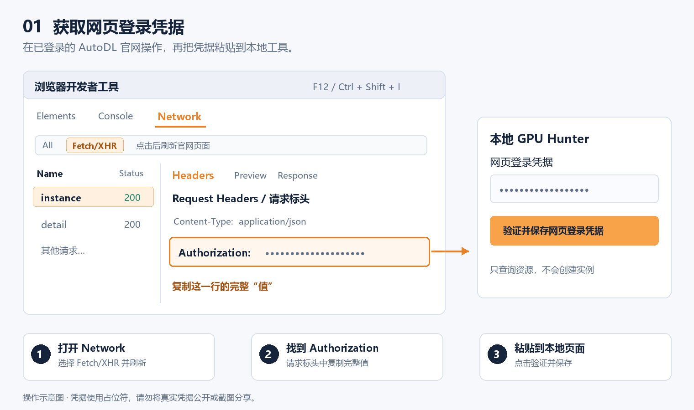
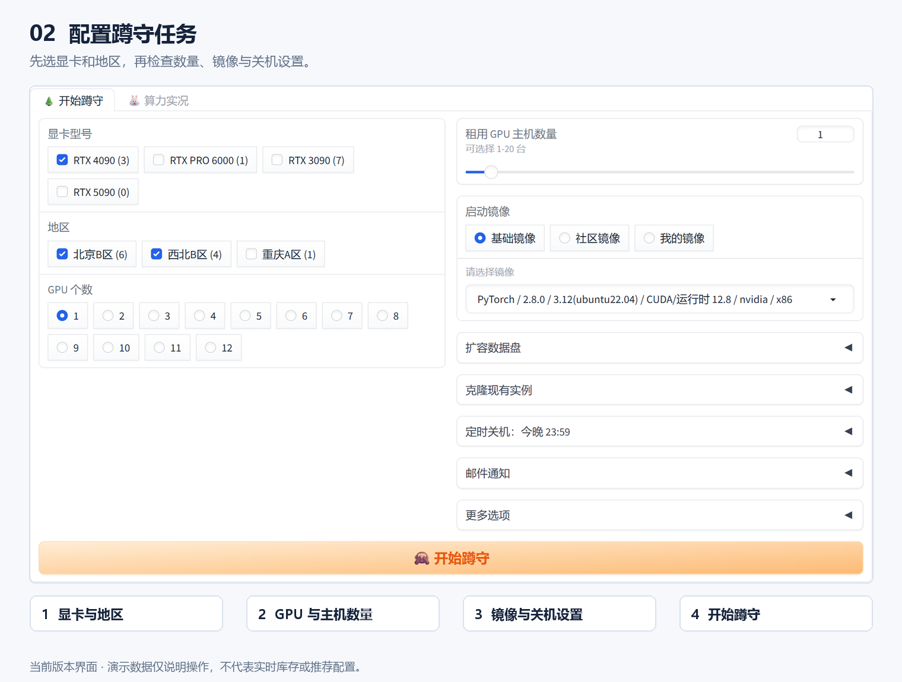
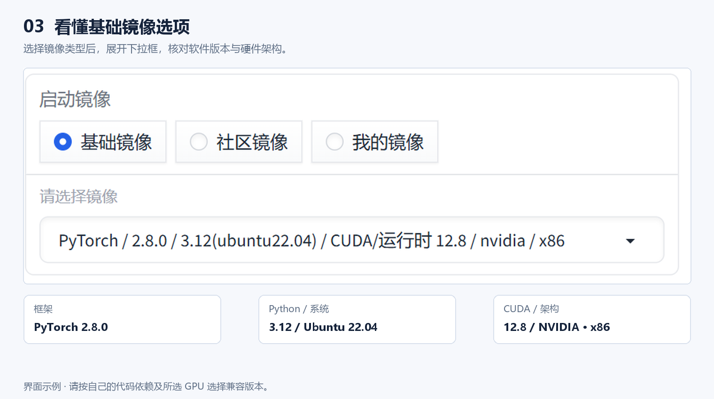

# AutoDL GPU Hunter

在本机运行的 AutoDL 普通容器实例 GPU 蹲守工具。选择显卡、地区和镜像后，程序会定时查询库存，并在符合条件时尝试创建按量付费实例。

> **费用提醒：**验证网页登录凭据只查询 AutoDL 资源。点击“开始蹲守”后，程序可能自动创建付费实例。停止本地程序不会关闭已经创建的云端实例，请在 AutoDL 控制台单独管理。本项目适配普通容器实例，不支持 Pro 实例流程，也不是 AutoDL 官方产品。

[快速开始](#快速开始) · [登录配置](#登录配置) · [开始蹲守](#开始蹲守) · [常见问题](#常见问题) · [提交问题](https://github.com/cchao-jlu/autodl-gpu/issues)

## 功能

- 按 GPU 型号、地区、每台 GPU 数量和主机数量筛选库存。
- 支持基础镜像、社区镜像和个人镜像。
- 支持数据盘扩容、克隆实例、定时关机和邮件通知。
- 服务默认只监听 `127.0.0.1`，不会创建 Gradio 公共分享链接。
- 库存读取遇到部分临时错误时有限重试；创建请求不会自动重试，避免不确定时重复创建。

## 快速开始

需要 Git 和 **Python 3.11**。本地运行不需要 GPU 或 CUDA。macOS 已使用 Python 3.11 验证安装、启动和登录校验；Windows 提供启动脚本；Linux 尚未实机验证。

### macOS / Linux

在终端执行：

```bash
git clone https://github.com/cchao-jlu/autodl-gpu.git
cd autodl-gpu
python3.11 -m venv .venv
.venv/bin/python -m pip install -r requirements-local.txt
PYTHONUTF8=1 GRADIO_ANALYTICS_ENABLED=False .venv/bin/python app.py
```

启动后打开 <http://127.0.0.1:7860>。在终端按 `Ctrl+C` 停止服务。也可以使用 `uv` 创建环境并安装依赖：

```bash
uv venv --python 3.11 .venv
uv pip install --python .venv/bin/python -r requirements-local.txt
```

然后运行最后一条 `app.py` 启动命令。

### Windows / PowerShell

已安装 Python 3.11 时：

```powershell
git clone https://github.com/cchao-jlu/autodl-gpu.git
cd autodl-gpu
py -3.11 -m venv .venv
.\.venv\Scripts\python.exe -m pip install --upgrade pip
.\.venv\Scripts\python.exe -m pip install -r requirements-local.lock.txt
.\start-local.cmd
```

启动后打开 <http://127.0.0.1:7860>。之后可双击 `start-local.cmd` 启动、`stop-local.cmd` 停止后台服务。关闭浏览器不会停止服务。需要在终端查看输出时，可运行：

```powershell
$env:PYTHONUTF8 = '1'
$env:GRADIO_ANALYTICS_ENABLED = 'False'
.\.venv\Scripts\python.exe app.py
```

终端启动的进程用 `Ctrl+C` 停止。不要同时启动多个蹲守进程。

`requirements-local.txt` 为 macOS/Linux 等环境提供兼容依赖约束；`requirements-local.lock.txt` 是 Windows 与 Python 3.11 的已验证版本快照。不要只安装原始 `requirements.txt`，以免 Gradio 与间接依赖版本不兼容。

## 登录配置

普通容器实例需要 AutoDL 官网的**网页登录凭据**。开发者 Token 不能替代它。

1. 在浏览器登录 [AutoDL 容器实例控制台](https://www.autodl.com/console/instance/list)。
2. 打开开发者工具：Mac 上的 Chrome/Edge 按 `⌘ Command + ⌥ Option + I`；Windows 按 `F12` 或 `Ctrl+Shift+I`。
3. 选择 **Network / 网络 → Fetch/XHR**，刷新控制台页面。Mac 按 `⌘ Command + R`，Windows 按 `Ctrl+R`。如果筛选框里已有文字（例如 `auth`），先清除筛选。
4. 找到 `https://www.autodl.com/api/v1/instance` 请求，打开 **Headers / 标头 → Request Headers / 请求标头**，复制 `Authorization` 对应的值。确认选中的是 `instance` 请求，而不是名称里含 `cloudauth` 的请求。
5. 将该值粘贴到本地页面的“网页登录凭据”，点击“验证并保存网页登录凭据”。



*凭据获取操作示意；图中使用占位符。*

如果请求标头里找不到 `Authorization`，可在开发者工具的 **Application / 应用 → Storage / 存储 → Local Storage / 本地存储** 中选择 AutoDL 当前页面的站点，复制 `token` 的 **Value**。只复制值，不要带字段名、引号或整段请求内容。

验证只读取地区、GPU 和实例列表；全部成功后才会保存凭据。验证失败会保留之前已保存的配置。凭据可能过期，届时请重新登录官网并验证新值。

凭据以明文保存在本机 `runtime/data/config.json`，其中还可能包含邮件设置。不要分享该文件、请求标头或含凭据的截图。`runtime/` 运行数据已加入 Git 忽略规则。

## 开始蹲守



*当前版本界面，使用演示数据。图中的库存和配置仅用于说明操作。*

1. 选择 GPU 型号、地区、每台 GPU 数量及目标主机数量。
2. 选择启动镜像，并确认镜像与目标 GPU、软件环境兼容。
3. 检查扩容、克隆、邮件通知和定时关机选项；本机运行时，“守到后将 Hunter 关机”应设为“不关机”。
4. 点击“开始蹲守”。程序会保存设置、定时查询库存，并在条件满足时尝试创建实例。开始前请再次核对主机数量和费用设置。
5. 点击“停止”可停止后续扫描。已经发出的请求可能仍在处理，请先在 AutoDL 控制台确认实例状态，再决定是否重试。



*镜像选择示例：核对框架、Python、CUDA 与硬件架构后，再开始蹲守。*

默认扫描间隔为 30 秒，可设置为 10–600 秒。工具无法保证抢到库存。停止 Hunter、关闭浏览器或关闭本机，都不会自动关停云端实例。

## 常见问题

| 现象 | 处理方法 |
| --- | --- |
| 开发者 Token 提示登录失败 | 改用官网网页登录凭据，见[登录配置](#登录配置)。 |
| Network 中找不到 `Authorization` | 确认已登录实例控制台，清除 Network 筛选并查找 `api/v1/instance`；也可检查 Local Storage 中的 `token`。 |
| 登录凭据过期 | 重新登录 AutoDL 控制台，获取并验证新的凭据。 |
| 库存查询出现 `DatabaseError` 或临时网络错误 | 只读库存请求最多尝试 3 次，仍失败会跳过本轮并等待下一次扫描；创建请求不自动重试。 |
| 页面出现 Gradio/FastAPI 或 `HfFolder` 导入错误 | 在独立 `.venv` 中按对应平台的依赖文件重新安装。 |
| 7860 端口被占用 | 先停止已有 Hunter 服务，或处理占用该端口的程序。 |
| 显卡空闲数量为 0 | 当前查询没有符合条件的空闲库存，持续扫描也不保证一定能租到。 |

Windows 后台服务日志位于 `runtime/logs/web.stdout.log` 和 `runtime/logs/web.stderr.log`；蹲守输出和详细日志分别为 `output.log` 与 `main.log`。提交问题前请先从日志中删除凭据及其他个人信息。更多 Windows 操作说明见 [LOCAL-SETUP.md](LOCAL-SETUP.md)。

## 许可证

本项目基于 [ansatzia/autodl-gpuhunter](https://github.com/ansatzia/autodl-gpuhunter) 整理与修复，并保留上游提交历史和版权声明。采用 [MIT License](LICENSE)。AutoDL 云资源由平台收费，使用前请确认平台规则与费用。
